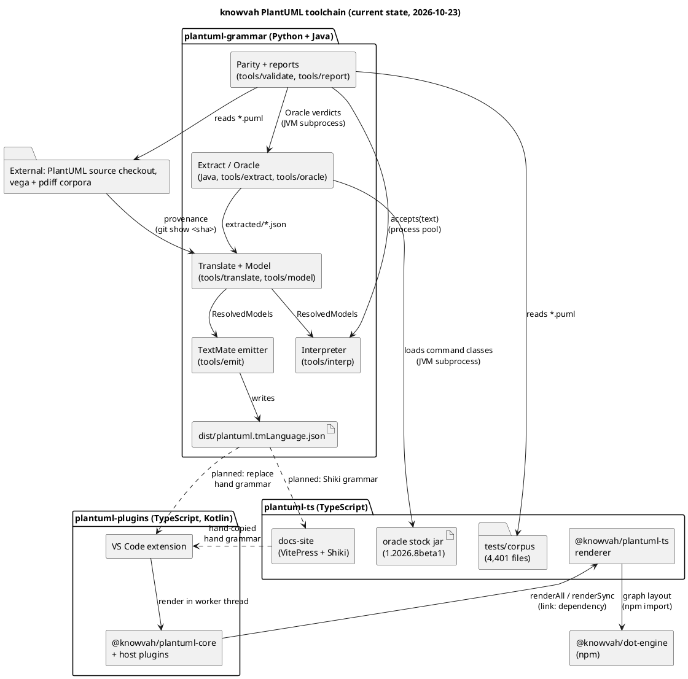

# System architecture

These are three repositories with no runtime services. Every connection is a filesystem
path, a subprocess or an npm package. The diagram shows the current state. The dashed edges
labelled "planned" are the intended wiring of the generated grammar and are not yet in
place.

## Communication summary
| From | To | Mode | Protocol / mechanism |
|---|---|---|---|
| tools/extract, tools/validate/oracle.py | PlantUML jar | sync, batch | `java -cp build/java:<jar>` subprocess; paths on stdin, one JSON verdict line per file on stdout |
| tools/translate/provenance.py | PlantUML source checkout | sync | `git show <pin-sha>:<file>` subprocess |
| tools/validate/parity_run.py | tools/interp | parallel, in process | `ProcessPoolExecutor`, `interp.accepts` |
| tools/emit | editors | build artifact | JSON file (not yet published to npm) |
| plantuml-plugins core | plantuml-ts | in process | ES module import through a `link:` dependency |
| VS Code extension host | render worker | async | `worker_threads` message (`{ok, svg}`) with a configurable timeout |
| plantuml-ts | dot-engine | in process | npm import (`createGraph` / `render` / `getLayout`) |
