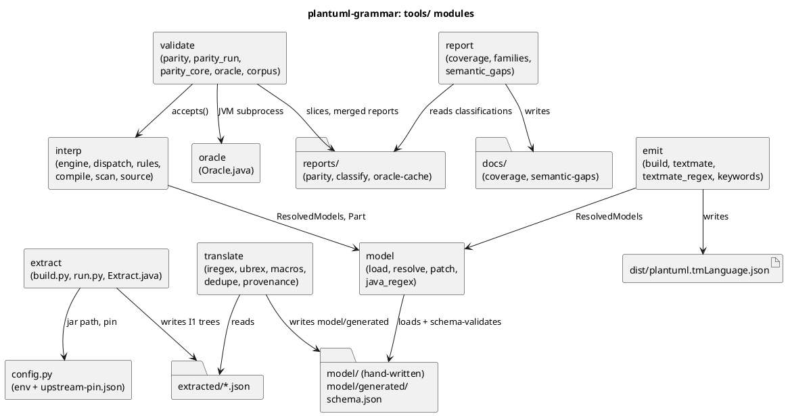
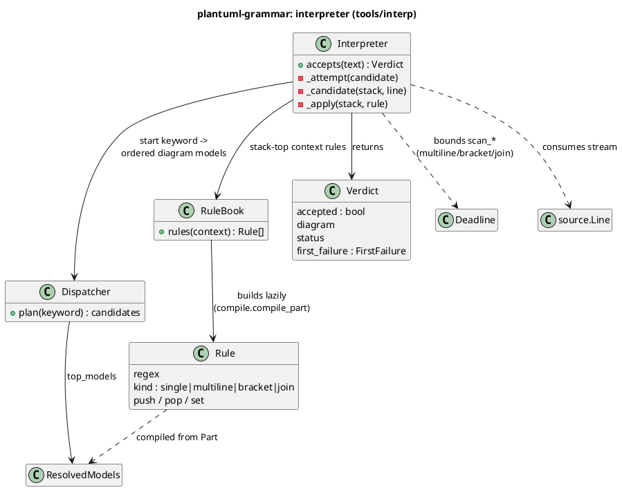
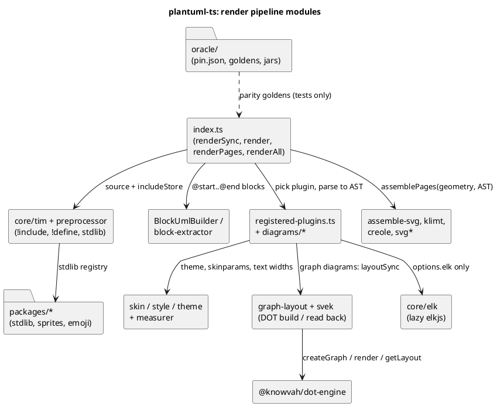
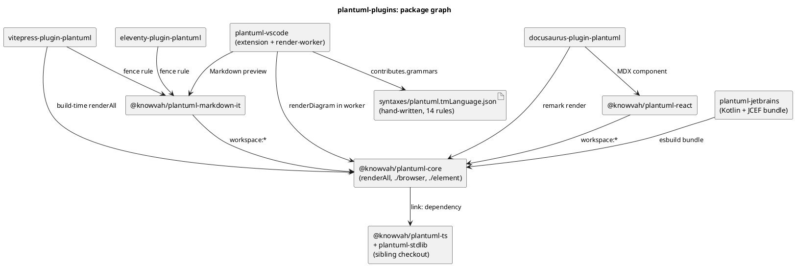

# Components

## plantuml-grammar

### Module structure
The `tools/` packages and the files they read and write. Each edge is labelled with what
crosses it.

### Interpreter types
The interpreter's main types. The model is the input data; `Interpreter` is the runtime
that applies it.

### Model layering
- `model/schema.json` (JSON Schema 2020-12) validates every YAML file.
- Hand-written files:
  - `model/document.yaml`, `preproc.yaml`, `shared.yaml` and `creole.yaml`.
  - `model/diagrams/*.yaml`, which refine generated entries with `overrides`,
    `insert_before` and `insert_after`.
  - `model/embedded/*.yaml`.
- Generated files: `model/generated/gen-*.yaml` and `gantt-lang.yaml`, each headed "GENERATED
  by tools/translate - do not edit".
- `load_dir` puts every file into one namespace, and a file's id must equal its stem.
  `resolve` then:
  1. merges model-level `include`;
  2. splices context `{include: NAME|MODEL#CONTEXT}`;
  3. substitutes `{ref: VAR}`;
  4. applies patches, failing on any that no longer match.

## plantuml-ts

## plantuml-plugins

