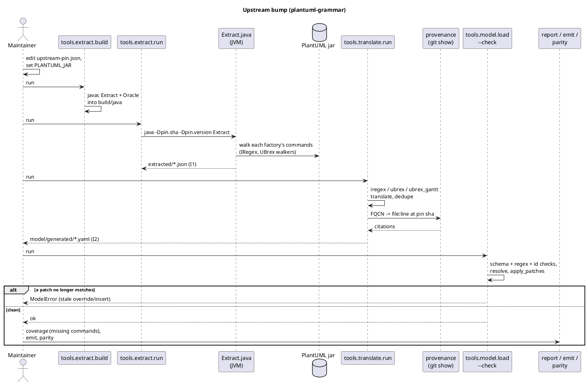
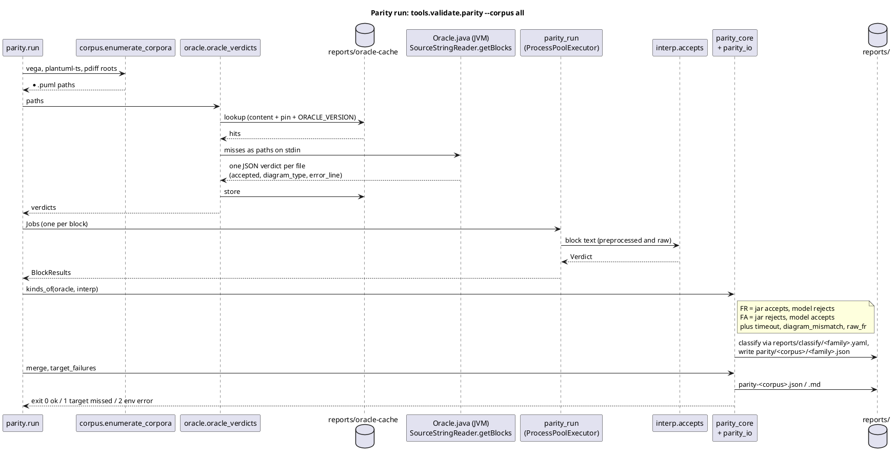
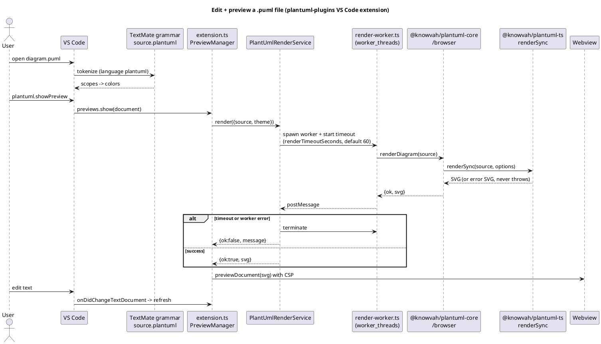

# Data flows

## 1. Upstream bump: regenerate the model
A maintainer moves the pin to a new PlantUML commit. Every downstream artifact is
regenerated, and stale hand-written patches fail loudly.

## 2. Parity validation against the jar
This flow is how correctness is measured. Each `@start...@end` block is judged by both the
jar and the interpreter, and every disagreement is classified.

## 3. Highlighting and rendering a PlantUML file in VS Code
This is the user-facing editor flow. Highlighting comes from the hand-written grammar
today. The planned swap replaces only the grammar file, with plantuml-grammar's generated
`dist/plantuml.tmLanguage.json`, which has the same scope `source.plantuml`.

